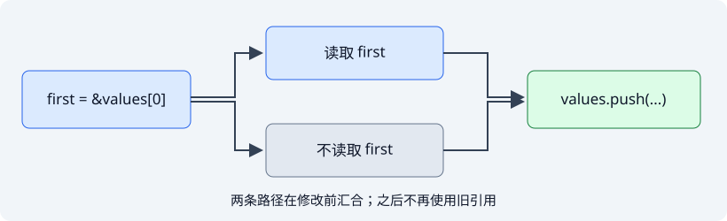

# 1. 借用检查器到底在检查什么

> 一句话：借用检查器**不读你的意图**。它只在一个控制流图上做数据流分析——
> 而它能看到的"变量"，和你写的那些变量**不是同一批**。

## 先把语法认清

`&T` 创建共享借用，只读且可以同时存在多份；`&mut T` 创建独占借用，
借用有效期间不能再通过其他路径访问同一数据。借用不转移所有权：函数可以
临时读取或修改调用者的数据，而不必接管或复制它。

```rust
fn normalize(name: &mut String) { name.make_ascii_lowercase(); }
fn display(name: &String) { println!("{name}"); }
```

可以先把引用想成一张**临时权限票**：`&T` 借你看，`&mut T` 借你独占地改；
票还有效时，所有者就不能做会与它冲突的事。后面看 MIR，只是在看这些票
究竟从哪里生效、在哪里失效。

### 放到业务里：批处理记录后更新容器

服务端常先从 `Vec<Order>` 取出一条记录用于校验，再更新整个列表。关键不是
"引用在哪个大括号里"，而是它最后一次在哪里使用：若校验结果已经复制出来，
后续 `push` 可以合法发生；若后面还要读取原引用，扩容可能使它失效，编译器就会
拒绝。这正是阅读 E0502 时应寻找“创建点、冲突点、最后使用点”的原因。

```rust,ignore
let total = orders[0].total; // 把后续需要的信息取出来
orders.push(new_order);      // 对 orders 的借用已经结束
audit(total);
```

这里不是靠 `clone()` 躲过检查，而是先拿出真正需要的值，让借用自然结束。

## 1.0 一个会让你卡住的例子

先看这段代码。它编译不过：

```rust,ignore
let mut v = vec![1, 2, 3];
let first = &v[0];
v.push(4);            // error[E0502]
println!("{first}");
```

再看这段。它**能**编译过：

```rust
let mut v = vec![1, 2, 3];
let first = &v[0];
println!("{first}");
v.push(4);            // OK
```

两段代码的差别，只是把 `push` 和 `println!` 换了个位置。

于是你很容易得出一个错误结论："借用要在**作用域结束**才释放，所以第一段里
`first` 一直活着，`v` 就不能被可变借用。"

**这个结论是错的。** 如果借用真的活到作用域结束，第二段代码同样会报错——
`first` 和 `v` 在同一个块里，作用域是一样的。但它编译过了。

所以问题不是"作用域"。那是什么？

## 1.1 先把常见说法摆上桌

通常我们先记住三条规则：

- 同一时刻，要么有**一个**可变引用，要么有**任意多个**不可变引用；
- 引用必须始终有效（不能悬垂）；
- 借用的生命周期不能超过被借用的值。

这三条都对，但它们描述的是**结论**，不是**机制**。它们没有回答你真正的问题：
"同一时刻"到底是哪一刻？借用"活着"是什么意思？

要回答这个，得看编译器**实际在处理什么**。

## 1.2 编译器眼里的样子

### 1.2.1 先看错误信息：它在给你指三个点

借用检查器报错时，会标出三段位置。这不是排版好看，这是它的**全部推理过程**：

```text
error[E0502]: cannot borrow `v` as mutable because it is also borrowed as immutable
  --> fail/E0502.rs:23:5
   |
22 |     let first = &v[0];
   |                  - immutable borrow occurs here          ← ① 借用的产生点
23 |     v.push(4);
   |                  ^^^^^^^^^ mutable borrow occurs here    ← ② 冲突点
24 |     println!("{first}");
   |                ----- immutable borrow later used here    ← ③ 最后一次使用点
```

三个点：

1. **借用在哪里产生**（`&v[0]`）；
2. **冲突发生在哪里**（`v.push(4)`）；
3. **借用最后一次被用在哪里**（`println!("{first}")`）。

第三点是关键。借用检查器认为 `first` 的"存活区间"是**从①到③**，
而不是"从①到作用域结束"。② 落在 [①, ③] 中间，所以冲突。

回头看不报错的那段：`println!` 在 `push` **之前**，③ 跑到了 ② 前面，
区间不再重叠，于是合法。

> 这就是 **NLL（non-lexical lifetimes）** 的字面含义：
> 存活区间由**使用点**界定，而不是由**词法块**界定。
> Rust 2018 之前确实是按词法块算的，那时候第二段代码也编译不过。

### 1.2.2 再看 MIR：借用检查器真正在读的东西

光看错误信息还不够——我们想知道**它内部的数据结构长什么样**。

生成 MIR：

```bash
rustc --edition 2024 --emit=mir -o ch01.mir --crate-type=lib \
      examples/ch01-borrow/src/lib.rs
```

`examples/ch01-borrow/src/lib.rs` 里的 `simple()`：

```rust,ignore
pub fn simple() -> f64 {
    let mut p = Point { x: 1.0, y: 2.0 };
    let r = &p;
    let v = r.x;
    p.x = 3.0;
    v + p.y
}
```

它的 MIR（**完整**，就这么多）：

```text
fn simple() -> f64 {
    let mut _0: f64;
    let mut _1: Point;
    let mut _4: f64;
    scope 1 {
        debug p => _1;
        let _2: &Point;          // ← ① 借用是"一个具名的局部变量"
        scope 2 {
            debug r => _2;
            let _3: f64;
            scope 3 {
                debug v => _3;
            }
        }
    }

    bb0: {
        _1 = Point { x: const 1f64, y: const 2f64 };
        _2 = &_1;                  // ← ② 借用在这里"产生"
        _3 = copy ((*_2).0: f64);  // ← ③ 最后一次使用 _2
        (_1.0: f64) = const 3f64;  // ← ④ 写 p.x
        _4 = copy (_1.1: f64);
        _0 = Add(copy _3, move _4);
        return;
    }
}
```

这里有几件事值得停下来看：

**（a）`&p` 变成了一个真实的局部变量 `_2`。**
你写的 `let r = &p` 在 MIR 里不是一个"注解"，而是一条赋值语句
`_2 = &_1` —— 借用在 MIR 里**是一个值**，占一个变量槽。
`debug p => _1` / `debug r => _2` 只是给变量挂了个名字方便你看。

**（b）整个函数体只有一个基本块 `bb0`。**
没有分支、没有循环，所以"控制流图"退化成了直线。
这让"存活区间"变得肉眼可读：

- `_2` 在第 2 行产生；
- 在第 3 行被读（`copy ((*_2).0)`）——**这是它最后一次被使用**；
- 第 4 行写 `_1.0`（也就是 `p.x`）。

**（c）第 4 行的写和第 3 行的读之间，`_2` 已经死了。**
借用检查器要证的就是这件事：写 `_1` 的那一刻，`_2` 是否还"活着"？
它用的判据是：`_2` 后面**还有没有使用点**。没有，就是死的。

于是 `p.x = 3.0` 合法。**不是因为"作用域结束"，而是因为后面没人再用 `_2`。**

### 1.2.3 换个写法，让它"死得再明显一点"

`simple()` 里借用是自动结束的（`r.x` 之后就没了）。再看一个更刻意的例子：

```rust,ignore
pub fn nll_ok() -> u64 {
    let mut c = Counter { n: 0 };
    let r = &c.n;        // 共享借用产生
    let seen = *r;       // ← 最后一次使用 r
    c.bump();            // ← 可变借用
    seen + c.n
}
```

MIR：

```text
bb0: {
    _1 = Counter { n: const 0_u64 };
    _2 = &(_1.0: u64);                 // ← ① 共享借用产生
    _3 = copy (*_2);                   // ← ② 最后一次使用 _2（存进 seen）
    _5 = &mut _1;                      // ← ③ 可变借用：合法
    _4 = Counter::bump(move _5) -> ...;
}
```

把 `let seen = *r;` 移到 `c.bump()` 后面，就会报 E0502：共享借用在可变借用之后
仍被读取。若只是删掉读取并同步删掉对 `seen` 的使用，借用反而可能更早结束。

**变的只是使用点的位置。词法作用域一点没动。**
这是 NLL 最干净的一个演示。

### 1.2.4 一条实用的验证路径

`--emit=mir` 有一个很好用的性质：**借用检查失败的程序根本不会生成 MIR**。

```bash
$ rustc --edition 2024 --emit=mir -o out.mir --crate-type=lib fail/E0502.rs
error[E0502]: cannot borrow `v` as mutable because it is also borrowed as immutable
...
$ ls out.mir
ls: out.mir: No such file or directory
```

这说明 `--emit=mir` 输出的是**借用检查通过之后**的产物。
你看到的那份 MIR，是"检查器已经认可的世界"——
**你读它，就是在读借用检查器认可了什么。**

> ⚠️ 三个容易踩的坑（都实测过）：
> 1. 库代码要加 `--crate-type=lib`，否则 rustc 会按 bin 处理，报 `main` 函数找不到；
> 2. **不需要** `-o`，裸写 `--emit=mir` 就会生成 `x.mir`；
>    但写 `-o /dev/null` 会报 `couldn't create a temp dir`（`/dev` 不可写）；
> 3. `-o` 后面**不能是已存在的目录**，会报
>    `conflicts with the existing directory`。
>
> 另外：`-Zunpretty=mir` 需要 nightly。**本书用 stable 的 `--emit=mir`，
> 读者零额外安装。**

## 1.3 为什么必须这样设计

借用检查器为什么不能"理解你的意图"？

因为它要处理的是一段**任意复杂的控制流**。真实代码里有 `if`、`match`、
`loop`、`?`、提前 `return`……"借用活到哪"这个问题在一般情形下没有简单答案，
只能化成**数据流分析**：

> 对控制流图上的每个点，算出"此刻哪些借用还活着"。
> 活着的判据是：从这个点出发，**存在一条路径**能走到该借用的某个使用点。

这是一条理解普通局部借用的简化规则，不是完整的借用检查算法。返回引用、
析构器和跨函数签名还会引入额外约束，不能只按文本上的最后一行使用判断。



先看两个都能通过的分支例子：

```rust
// 编译过：if/else 两个分支里都用掉了借用，
// 走到 if 之后，再也没有路径能到达使用点
pub fn ok(flag: bool) -> usize {
    let mut v = vec![1u64, 2, 3];
    let first = &v[0];
    if flag { println!("{first}"); } else { println!("{first}"); }
    v.push(4);            // OK
    v.len()
}

pub fn one_branch(flag: bool) -> usize {
    let mut v = vec![1u64, 2, 3];
    let first = &v[0];
    if flag { println!("{first}"); }
    v.push(4);
    v.len()
}
```

只有一个分支使用引用，不会让引用自动活到整个作用域末尾。两个函数的 `push`
都发生在条件使用之后；所有能够到达 `push` 的路径都不再读取 `first`。
反例 `fail/use_after_conflict.rs` 的真正差别是把 `push` 放在 `if` 前面：

```rust,compile_fail,E0502
pub fn use_after_conflict(flag: bool) -> usize {
    let mut v = vec![1u64, 2, 3];
    let first = &v[0];
    v.push(4);
    if flag { println!("{first}"); }
    v.len()
}
```

这里确实存在一条路径，在 `push` 之后仍使用旧引用。Vec 可能扩容，引用可能
失效，所以拒绝有直接的安全理由；不是因为有一个分支没有使用引用。

## 1.4 反直觉的点

### 反直觉之一：使用点决定一切，而不是作用域

```rust
let mut v = vec![1, 2, 3];
let first = &v[0];
println!("{first}");
v.push(4);
```

这里最后一次读取引用发生在 `push` 之前，所以可以通过。

反过来，如果你写：

```rust,compile_fail,E0502
let mut v = vec![1, 2, 3];
let first = &v[0];
v.push(4);
println!("{first}");
```

冲突就出现了。不要用 `let _ = first` 替代这个读取：通配模式不会绑定、移动
或读取这个引用值，放在 `push` 后面也不会产生同样的借用冲突。

**实践含义**：被 E0502 卡住时，调**作用域**通常没用，
调**使用点的位置**才有用。（当然，正确做法是先想清楚这段代码
是不是真的该同时持有两个借用——但至少你要知道工具在量什么。）

### 反直觉之二：检查的对象是"权限冲突"，不是"可变性"

错误信息说 "cannot borrow `v` as mutable because it is also borrowed as immutable"。
措辞容易让人以为存在"可变性检查"。但看 MIR：

```text
_2 = &_1;        // 共享借用
_5 = &mut _1;    // 可变借用
```

**两条语句形状完全一样**，都是"把一个引用赋给一个局部变量"。
借用检查器关心的不是"哪个是 `&` 哪个是 `&mut`"，而是：

> 两个借用的**存活区间有没有重叠**；重叠时，**权限是否兼容**。

共享 + 共享：兼容。
共享 + 可变、可变 + 可变：不兼容。

**权限冲突**，才是它真正在检查的东西。而权限的定义，
直接来自你在类型上写的 `&` / `&mut`。

### 反直觉之三：被拒绝的代码不一定"真的有问题"

在 Rust 1.99.0 / Edition 2024 上，下面这个经典例子仍被拒绝：

```rust,compile_fail,E0502
pub fn last_or_push(values: &mut Vec<String>) -> &String {
    if let Some(last) = values.last() {
        return last;
    }
    values.push(String::new());
    values.last().unwrap()
}
```

从控制流看，有元素就返回、没有元素才 push，两条路径不需要同时持有引用。
但返回值的生命周期约束使当前分析不能把这两条路径完全分离，`push` 仍报 E0502。
这类条件返回借用的精度问题是 Polonius 研究的典型动机之一；这里不依赖其
开发状态，只把当前 stable 的诊断固化为反例 `fail/conditional_return.rs`。

不必用 `unsafe` 绕过它。先只检查是否为空，把返回借用推迟到最后即可：

```rust
pub fn last_or_push(values: &mut Vec<String>) -> &String {
    if values.is_empty() {
        values.push(String::new());
    }
    values.last().unwrap()
}
```

可迁移的判断规则是：若某个分支提前返回借用，后面还要修改同一个对象，先尝试
把“决定是否修改”和“最终借出引用”分成两个阶段。拒绝不一定意味着代码必然
不安全，但接受一个改写也不能反过来证明所有类似程序都安全。

## 1.5 亲手验证

```bash
# 生成 MIR（stable 即可，无需 nightly）
rustc --edition 2024 --emit=mir -o ch01.mir --crate-type=lib \
      examples/ch01-borrow/src/lib.rs

# 看正例
grep -A12 '^fn simple' ch01.mir
grep -A14 '^fn nll_ok' ch01.mir

# 看反例（预期报 E0502，且不生成 .mir）
rustc --edition 2024 --crate-type=lib examples/ch01-borrow/fail/E0502.rs
```

**怎么算验证成功**：

1. `simple` 的 MIR 里，`_2 = &_1` 之后能看到
   `_3 = copy ((*_2).0: f64)`，**再往后 `_2` 不再出现**，
   而 `(_1.0: f64) = const 3f64` 出现在它之后 —— 这就是"借用死了才写"；
2. `nll_ok` 的 MIR 里，顺序必须是
   `_2 = &(_1.0: u64)` → `_3 = copy (*_2)` → `_5 = &mut _1`；
3. 反例报 E0502，且**当前目录下不会出现 `.mir` 文件**。

这三条都写成了自动断言：

```bash
cargo test -p ch01-borrow
scripts/verify-evidence.sh ch01
```

## 1.6 与 unsafe 的关系

借用检查器的规则，**不是建议，是健全性前提**。

一旦你绕过它（`unsafe` 里的裸指针、`transmute`、`UnsafeCell`），
下面这些保证就**不再有人替你维护**：

- **别名规则**：`&mut` 独占、`&` 共享且无人写。这些保证会被写进 LLVM IR
  变成 `noalias` 元数据（第 24 章），LLVM 拿它做优化。
- **有效性**：引用指向的内存在使用期间必须活着。打破它 = 悬垂指针 = UB。
- **可读性**：`&T` 指向的 `T` 必须已初始化。

Miri 能把这三类错误抓出来——哪怕它们在普通运行下看起来完全正常：

```text
$ cargo +nightly-2026-09-16 miri test
error: Undefined Behavior: memory access failed: alloc291 has been freed,
       so this pointer is dangling
```

而同样这段代码 `cargo run` 会正常打印一个数字。
**UB 不保证当场崩，它只保证"编译器有权做任何事"。**
第 25 章会把这件事从头讲一遍。

## 1.7 小结

- **借用检查器做的是数据流分析**：在控制流图上算"每个借用此刻还活着吗"。
  它不读你的意图，只看 MIR 里变量的使用点。
- **借用在 MIR 里是一个真实的局部变量**（`_2 = &_1`），不是注解。
- **NLL = 存活区间由使用点决定**，不由词法块决定。
  这是 Rust 2018 之后第二段代码能编译过的原因。
- **权限冲突**才是检查对象，不是"可变性"。
  `&` / `&mut` 是给权限贴的标签。
- **`--emit=mir` 是借用检查之后的世界**：检查不过就没有 MIR 可看。
  所以 MIR 是"检查器认可了什么"的直接证据。
- **反直觉**：想解决 E0502，调作用域通常没用，**调使用点**才有用。
  而且被拒绝的代码不一定是错的——健全性检查必须保守。

下一章我们把这个模型推到生命周期上：那些 `'a` 到底是什么，
以及为什么说它是**约束求解**而不是"时间"。
